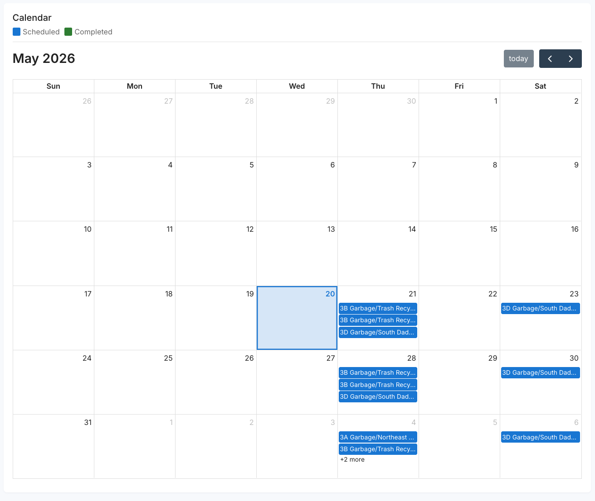

Three views help you keep tabs on your work orders: **Schedule**, **Work Orders**, and **History**. All live under Mobile Wash in [app.gorynse.com](https://app.gorynse.com).

<Note>
  Completed work orders usually appear within a few days of the wash — exact timing varies by vendor. Billing is separate: depending on what you've set up with Rynse, a mobile wash is either billed right after it's completed or rolled into your monthly invoice.
</Note>

## Schedule

**Mobile Wash → Schedule** is a month-view calendar with summary cards — the fastest way to answer "when's my next wash?" and "what landed last month?"

The calendar shows three kinds of events:

- **Scheduled** (purple) — upcoming visits coordinated with your vendor. A recurring visit may show an estimated vehicle count.
- **Active** (blue) — work orders that have been matched to a vendor and are in motion.
- **Completed** (green) — finished washes, shown on the day they were completed, with the vehicle count.

Click any day to see its entries in the side panel. Click an active or completed event to open the work order detail.

<Frame caption="The Schedule calendar — purple events are scheduled visits, blue are active, green are completed washes">
  
</Frame>

<Note>
  Pending requests you've submitted appear on **Work Orders**, not on the Schedule calendar — they show up here once they're active. If a recurring visit you expect isn't on the calendar, it likely hasn't been dispatched — contact your account team.
</Note>

## Work Orders

**Mobile Wash → Work Orders** lists every work order for your organization, at any status, with a count of how many are in each status above the list. Click any row to open its detail.

| Column | What it shows |
| --- | --- |
| Created | When the work order was created. |
| Scheduled | The scheduled service date, or **—** until one is set. |
| Completed | When the wash was finished. |
| Status | `Requested`, `Active`, `Completed`, or `Cancelled`. Once an active order's scheduled date has passed, it shows **Invoicing**. |
| Number | Work order reference — quote it with support. |
| PO # | The purchase order on the request, or **—** if none. |
| Vehicles | Vehicles serviced (completed orders) or requested (open orders). |
| Facility | The facility the wash was requested for. |
| Vendor | Assigned vendor, once matched. |
| Requested By | Who submitted the request. |
| Requested Address | Where the crew was asked to go. A one-off address is marked **Address override**. |
| Amount | The order total, once it's priced. |

You can **Delete** a request while it's still `Requested` and hasn't been invoiced. You'll be asked to confirm, and it can't be undone.

To request a wash, click **Request work order** — see [Requesting a wash](/mobile-wash/requesting-a-wash).

### Opening a work order

Click any work order — from Work Orders, Schedule, or History — to see:

- **Where it stands.** The status and a plain-language message. A pending request also shows its progress: **Request submitted → Vendor assignment → Service scheduling → Active**.
- **Request details.** Work order number, who requested it, your preferred date window and arrival time, purchase order, facility, services, service address, and vendor (**—** until one is assigned). Once active, it adds the scheduled date and an **Estimated arrival**.
- **Results.** Completed orders show the completion date and each vehicle serviced, with its service, **Price**, and **Amount** — the figures on your invoice.
- **Pictures.** If photos were added, click any thumbnail to page through them full size, each labeled with its vehicle. To see one vehicle's photos, click the icon in its **Pictures** column.

## History

**History** lists only **Completed** and **Cancelled** work orders, so you can reconcile without active work in the way. It isn't one of the Mobile Wash tabs — go to [app.gorynse.com/mobilewash/history](https://app.gorynse.com/mobilewash/history) directly.

Each entry shows the work order number, date, vehicle count, and facility. Click **View results** (or **View details** for a cancelled order) for per-vehicle services and pricing — useful for matching invoice line items, reviewing a vendor's work, or pulling records for accounting.

## Common workflows

<AccordionGroup>
  <Accordion title="Checking the status of a request I submitted">
    Open **Work Orders**. New requests appear at the top as `Requested`. Open it to see what's left before the wash is booked. Once a vendor is assigned, it moves to `Active`. Sitting at `Requested` for more than a couple of days? Contact your account team.
  </Accordion>

  <Accordion title="Confirming next week's scheduled visit">
    Open **Schedule**. Recurring visits show as purple events on their expected dates. A missing date usually means the visit hasn't been dispatched — flag it with your account team.
  </Accordion>

  <Accordion title="Pulling records for accounting or reconciling an invoice">
    Open **History**, find the month you need, and click into each completed order for per-vehicle services and pricing. These tie back to the line items on your invoice.
  </Accordion>

  <Accordion title="Investigating a complaint about a specific wash">
    Find the order in **History** by date and facility, then open the result to see which vehicles were serviced, what services they received, and any pictures on the order. If something looks off, contact your account team with the work order number.
  </Accordion>
</AccordionGroup>

## What's next

<CardGroup cols={2}>
  <Card title="Requesting a wash" icon="square-plus" href="/mobile-wash/requesting-a-wash">
    Submit an on-site wash request when you need vehicles handled outside the recurring cadence.
  </Card>

  <Card title="Fleet Wash Health" icon="heart-pulse" href="/rynse-web/fleet-wash-health">
    Pair Mobile Wash records with the wash health view to see which vehicles are getting attention and which are being missed.
  </Card>
</CardGroup>
